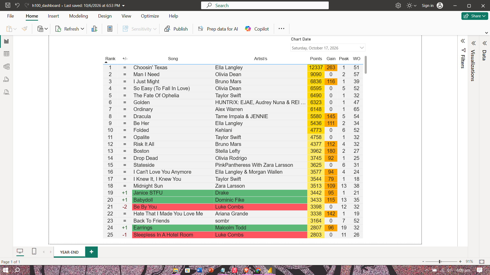
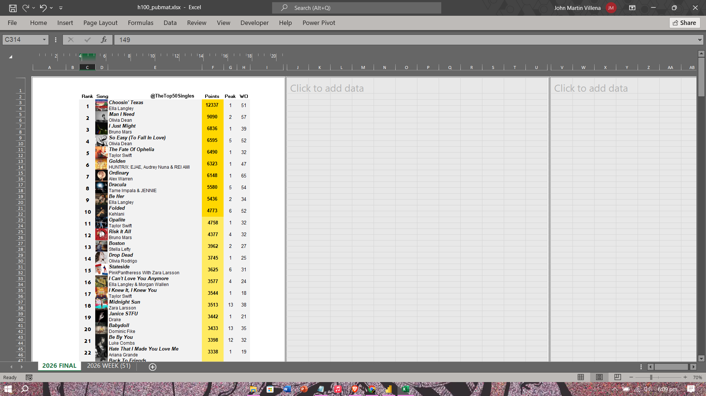
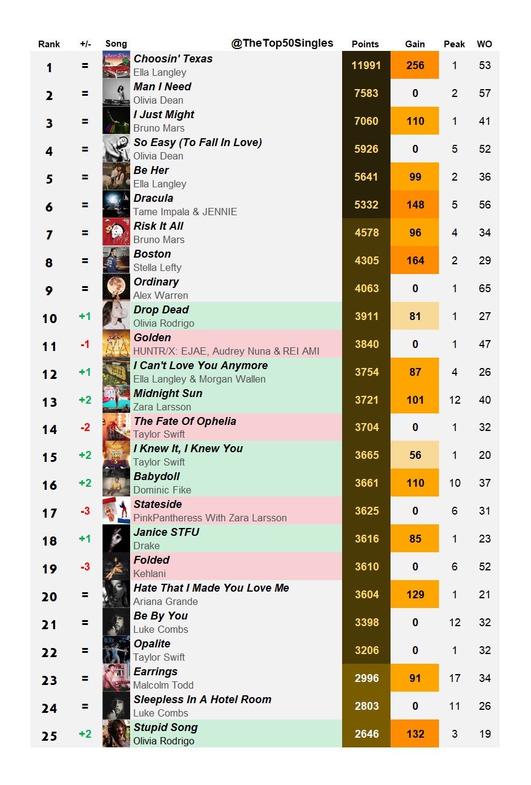

# Billboard Hot 100 Chart Tracker

A self-built data pipeline that tracks Billboard Hot 100 chart performance week over week, calculates custom yearly rankings, and produces a publication-ready weekly chart for social media. Maintained continuously since **December 2024**.

---

## Project Evolution

This project has gone through two distinct phases, kept side by side in this repo to show how it evolved:

- **v1 — Manual Excel + Power BI** (`v1-excel-powerbi/`): The original system. Chart data was tracked entirely by hand in Excel, cross-referenced into a publication file via XLOOKUP, and visualized in a Power BI dashboard driven by a manually-typed week number.
- **v2 — Python-Automated Pipeline** (`v2-python-automated/`): A rebuilt version that automates the weekly chart-data pull with a Python script, restructures the data into a long-format model (one row per song per week), and rebuilds the Power BI dashboard on a proper relational model with dynamic date-based filtering instead of a manually-typed week number. The latest iteration of v2 adds **period-aware ranking** (fixed year-end ranges *and* calendar-year views from the same model) and a **full visual redesign** of both the Power BI dashboard and the Excel publication file.

The rebuild wasn't just automation for its own sake — it fixed several real problems the original system had:

| Problem in v1 | Fix in v2 |
|---|---|
| Songs that didn't chart a given week vanished from Power BI visuals entirely | Added a dedicated `Songs` dimension table, so every song stays visible with `0` values instead of disappearing |
| Week number was typed in by hand each week | Replaced with a real date slicer, driven by an actual `Calendar` table |
| Two-hour manual weekly data entry for chart stats | `fetch_billboard.py` pulls rank, peak position, weeks on chart, and last-week position automatically in under five minutes |
| A new Excel tab had to be duplicated every year to reset year-end tracking | Year-end ranges are now defined in a single small lookup table (`Year-End Periods`) — a new year is one new row, not a duplicated workbook |
| Two songs sharing a title (e.g. two different artists' versions of the same Christmas song) could collide in lookups | Every lookup now matches on song **and** artist together, not title alone |
| Year-end ranges (Oct → Oct) and calendar-year views (Jan → Dec) overlap, but a date can only carry one period label | Added a second `Calendar Year` column, and made the `Points` / `Previous Points` measures period-aware, so both views run from the same model without duplicating measures or data |
| The first chart week of a new period was compared against the previous period's totals, producing nonsense movement | `Previous Points` now checks that the previous week belongs to the same period; the first week of any period shows every song as `NEW` with points equal to gain |
| Pubmat was exported by printing to PDF and converting to PNG, which left white page margins on any dark design | Export now uses Excel's **Copy as Picture** on a fixed range, so there are no paper margins and the dark version prints cleanly |

---

## From Raw Data to Published Output

### Power BI Dashboard


<!-- TODO: add screenshots of the redesigned dark dashboard (YE 2026 page, YE 2027 page, calendar-year page) -->

### Weekly Chart — Excel Publication Format


<!-- TODO: add screenshots of the light and dark pubmat versions -->

### Published Output — Twitter/X


---

## Overview

What started as a personal effort to follow weekly Billboard chart movement in more depth than the official charts show has grown into a structured, multi-layer data system:

1. **`h100_raw.csv`** — the automated data layer. A Python script (`fetch_billboard.py`) pulls each week's official chart stats (rank, peak position, weeks on chart, last-week position) directly from Billboard. Points — a custom metric not published by Billboard, sourced from public prediction data and corrected against the official chart — are entered manually into the same file.
2. **`h100_wide.xlsx`** — the reporting layer. Reshapes the long-format raw data back into a wide, week-by-week view (one sheet per tracking period, e.g. `(2025)`, `(2026)`, `(REAL-TIME 2026)`, `(2027)`) for visual growth-tracking and to feed the publication file. It also keeps the long-format `h100_raw` sheet with a `title|artist|date` key per row.
3. **`h100_pubmat.xlsx`** — the publication layer. Pulls ranked data from the wide-format file via XLOOKUP and formats it into a clean, ranked weekly chart used for publishing online. Light and dark versions are both maintained, and the colors are driven by conditional formatting rules rather than manual fills.
4. **`h100_dashboard.pbix`** — the visualization layer. A Power BI dashboard built on a proper relational model (fact table, Songs dimension, Calendar dimension, Year-End Periods table), visualizing chart trends and rankings with dynamic date-based slicing.

As of **October 24, 2026**, the system is tracking **1000+ songs** and **40,000+ individual weekly data points**.

---

## How It Works

**Data collection (weekly):**
`fetch_billboard.py` pulls the week's official chart stats automatically. Points are still entered manually, since Billboard doesn't publish its underlying scoring formula — this is sourced from public predictions and adjusted against the official placement once it's confirmed.

**Ranking model:**
A set of DAX measures (in v2) and Excel formulas (in v1) calculate each song's:
- `Points` — cumulative total from the start of the active period up to the selected week
- `Rank` — current standing based on total points
- `Peak` — highest position reached, as of the selected week
- `Weeks On` — number of weeks charting, as of the selected week
- `Gain` — points earned in the selected week specifically
- `+/-` — rank movement compared to the previous week within the same period (`NEW` when a song has no previous points)

**Period-aware logic (Power BI):**
Two kinds of period are supported from the same data:

| View | Defined by | Example |
|---|---|---|
| Fixed year-end range | A row in the `Year-End Periods` table, matched to each date in `Calendar` through a `Period Label` column (Power Query lookup) | Oct 25, 2025 → Oct 17, 2026 |
| Calendar year | A `Calendar Year` column (`Date.Year`) on the `Calendar` table | Jan 3, 2026 → Dec 26, 2026 |

`Points` and `Previous Points` check whether `Calendar Year` is filtered on the page. If it is, accumulation starts on January 1 of the selected year; otherwise it starts at the `Start Date` of the song's year-end period. Each page selects its view with a page-level filter (`Period Label` or `Calendar Year`), and the date slicers are unsynced between pages so the views stay independent.

```dax
Points =
VAR SelDate = [Selected Date]
VAR IsCY = ISFILTERED ( Calendar[Calendar Year] )
VAR CurrentPeriod =
    LOOKUPVALUE ( Calendar[Period Label], Calendar[chart_date], SelDate )
VAR PeriodStart =
    IF (
        IsCY,
        DATE ( YEAR ( SelDate ), 1, 1 ),
        LOOKUPVALUE (
            'Year-End Periods'[Start Date],
            'Year-End Periods'[Period Label], VALUE ( CurrentPeriod )
        )
    )
RETURN
CALCULATE (
    SUM ( h100_raw[chart_points] ),
    FILTER (
        ALL ( Calendar ),
        Calendar[chart_date] >= PeriodStart && Calendar[chart_date] <= SelDate
    )
)
```

**Power BI pages:**

| Page | Period | Page filter |
|---|---|---|
| YE 2025 | Oct 26, 2024 → Oct 18, 2025 | `Period Label = 2025` |
| REAL-TIME YE 2025 | Jan 4, 2025 → Dec 27, 2025 | `Calendar Year = 2025` |
| YE 2026 | Oct 25, 2025 → Oct 17, 2026 | `Period Label = 2026` |
| REAL-TIME YE 2026 | Jan 3, 2026 → Dec 26, 2026 | `Calendar Year = 2026` |
| YE 2027 | Oct 24, 2026 → Oct 16, 2027 | `Period Label = 2027` |


Starting a new year-end is one new row in `Year-End Periods`; a custom calendar-year page needs no new data at all.

**Dashboard design (Power BI):**
The dashboard was redesigned around a single color scheme: a black banner with a neon-green header and a dark charcoal page. Rows are tinted by movement (green for climbed, red for dropped), the `+/-` column uses ▲/▼ with matching font colors, and Points and Gain use tiered conditional formatting (not locked, top 100, 50, 25, 10 locked). Column widths are fixed so values going from three to five digits don't shift the layout, and the finished page is duplicated as the template for each new period.

**Publication layer (Excel):**
`h100_pubmat.xlsx` mirrors the ranked output from the wide-format file using XLOOKUP, then formats it into a clean weekly leaderboard — rank, movement, points, gain, peak, and weeks on chart — ready to publish. Colors are applied by conditional formatting rules, so the same sheet updates itself each week:

| Column | Rule |
|---|---|
| Points | Fill by locked tier — top 10, 25, 50, 100 — based on point thresholds |
| Gain | Fill by the song's **position on the current week's chart** (top 10, 25, 50, 100), read from a helper column; a separate quiet style when gain is `0` (recurrent songs) |
| Song / artist cells | Green for climbed (`+X`), red for dropped (`-X`), gray for unchanged (`=`), blue for `NEW` |
| `+/-` cells | Matching bold font colors |

Two implementation details worth noting:
- **Chart-position helper column.** An XLOOKUP on the `h100_raw` key (`title|artist|date serial`) returns each song's rank for the chart date typed in a single cell. Changing that one date updates every Gain color for the week.
- **Merged cells.** The `+/-` column is merged across each song's two stacked rows (title and artist), so the song-cell rules read the value from the row above when their own row is empty.

The final image is exported with Excel's **Copy as Picture → Save as Picture (PNG)**, which avoids the paper margins that the old print-to-PDF route left on dark designs.

---

## Files in This Repository

### `v1-excel-powerbi/`
| File | Description |
|------|-------------|
| `HOT 100 BREAKDOWN.xlsx` | Original raw weekly tracking data |
| `BREAKDOWN.xlsx` | Stacked long-format data feed for the original Power BI dashboard |
| `HOT 100 PUBMAT.xlsx` | Original publication output file, linked via XLOOKUP |
| `HOT 100 PROJECT.pbix` | Original Power BI dashboard |

### `v2-python-automated/`
| File | Description |
|------|-------------|
| `fetch_billboard.py` | Python script that pulls weekly chart stats automatically |
| `run_billboard.bat` | One-click launcher for the script |
| `h100_raw.csv` | Long-format source data — chart stats (automated) + points (manual) |
| `h100_wide.xlsx` | Reshaped wide-format reporting layer |
| `h100_pubmat.xlsx` | Formatted publication output, linked via XLOOKUP, with conditional-format color rules (light and dark versions) |
| `h100_dashboard.pbix` | Rebuilt Power BI dashboard — open with Power BI Desktop (free) |
| `h100_dashboard_screenshot.png` | Sample screenshot — Power BI visualization layer |
| `h100_pubmat_table.png` | Sample screenshot — Excel publication output |
| `h100_pubmat_final.JPg` | Sample — final graphic published to social media |

---

## Example — REAL TIME YEAR-END 2026 (top 5)

| Rank | +/- | Song | Artist | Points | Gain | Peak | WO |
|------|-----|------|--------|--------|------|------|----|
| 1 | = | Choosin' Texas | Ella Langley | 11 ,735 | +263 | 1 | 52 |
| 2 | = | Man I Need | Olivia Dean | 7,583 | +0 | 2 | 57 |
| 3 | = | I Just Might | Bruno Mars | 6,950 | +114 | 1 | 40 |
| 4 | = | So Easy (To Fall In Love) | Olivia Dean | 5,926 | +0 | 1 | 52 |
| 5 | = | Be Her | Ella Langley | 6,490 | +106 | 2 | 35 |

---

## Output & Publication

Weekly chart results are published consistently to:
- 📺 [YouTube — Top52Singles](https://www.youtube.com/@TheTop52Singles) — 35K+ subscribers, 152K+ average monthly views
- 🐦 [Twitter/X — @TheTop52Singles](https://x.com/TheTop52Singles)

---

## A Note on the Data

This dataset has grown organically since the project began in December 2024. Earlier weeks have minor structural differences — for example, some early sheets are missing the `Weeks On` column, and the column layout shifted slightly a few times as the tracking system matured. Rather than retroactively cleaning this history, it has been left intact as it reflects how the system actually evolved over a year and a half of continuous, hands-on maintenance.

The v1 files represent the system as it operated through most of that history. The v2 files represent the current, actively maintained version going forward.

---

## Tools Used

- **Python** — automated weekly chart-data collection (`billboard.py` package, with a planned migration to manual `requests` + `BeautifulSoup` scraping)
- **Microsoft Excel** — data tracking, ranking formulas, XLOOKUP-based cross-file reporting, rule-based conditional formatting, and PNG export for publishing
- **Microsoft Power BI** — Power Query data modeling (period lookups, calendar-year column), DAX measures, dashboard design and visualization of chart trends and song trajectories
- **CapCut** — used for related video content published alongside the chart data

---

## About

Built and maintained by **John Martin S. Villena**, BS Information Technology graduate (Business Analytics) from Bulacan State University.

🔗 [LinkedIn](https://www.linkedin.com/in/jhnmrtnvlln/)
📺 [YouTube](https://www.youtube.com/@TheTop52Singles)
🐦 [Twitter/X](https://x.com/TheTop52Singles)
